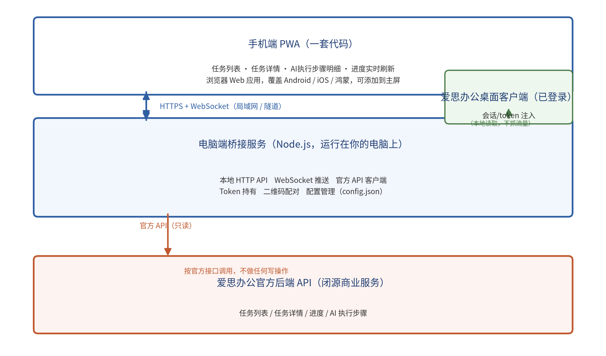

# 爱思办公手机协同端

**产品与技术架构文档**

| 项目 | 爱思办公手机协同端（非官方） |
| --- | --- |
| 文档 | 产品与技术架构文档 |
| 文档类型 | 架构文档 |
| 版本 | V0.1（MVP 实验版） |
| 日期 | 2026-10-05 |
| 定位 | 非官方 · 免费 · 开源 · 只读 |

# 1 总体架构（桥接模式）

## 1.1 架构概述

本系统采用桥接模式三层架构：手机端 PWA、电脑端桥接服务、爱思办公官方后端 API。桥接服务运行在用户电脑上，是手机与官方服务之间的唯一中转，持有官方会话，负责所有对官方接口的访问。

*图1 系统总体架构*

## 1.2 三层职责

| 层次 | 组件 | 运行位置 | 职责 |
| --- | --- | --- | --- |
| 展示层 | 手机端 PWA | 手机浏览器 | 任务列表/详情/步骤展示，实时刷新 |
| 桥接层 | 桥接服务（Node.js） | 用户电脑 | 本地 HTTP API、WebSocket 推送、官方 API 客户端、Token 持有、二维码配对 |
| 数据层 | 爱思办公官方后端 API | 官方服务器 | 提供任务数据（只读调用） |

## 1.3 为什么采用桥接模式

关键原因：官方 token 通常绑定设备与登录环境，手机浏览器直接调用官方接口会因 UA、设备指纹、登录态校验而失败；token 过期后需重新登录，而登录往往含验证码或设备校验，手机端无法自动完成。由电脑端桥接服务持有已登录会话并代理调用，可避开上述问题。

# 2 模块划分与职责

## 2.1 手机端 PWA

- 连接模块：扫码解析地址与配对码，管理连接状态。

- 列表模块：渲染任务列表。

- 详情模块：渲染任务详情与步骤明细。

- 实时模块：WebSocket 客户端，断线重连，降级轮询。

## 2.2 桥接服务（Node.js）

| 模块 | 职责 | 说明 |
| --- | --- | --- |
| 本地 HTTP API | 向手机端提供只读接口 | 任务列表/详情/健康检查 |
| WebSocket 推送 | 将进度变化实时推给手机 | 基于 ws 库 |
| 官方 API 客户端 | 封装对官方接口的调用 | 只读，按抓包结果实现 |
| Token 持有 | 读取并保存官方会话 token | 来自 config.json 或桌面端本地存储 |
| 配对模块 | 生成并校验二维码配对 | 生成一次性配对码 |
| 配置模块 | 读取 config.json | 管理地址、端口、token 等 |

## 2.3 数据流

手机 → 桥接服务（HTTPS/WebSocket）→ 官方后端（只读官方 API）。任务与步骤数据自官方后端单向流入手机端，全程无写操作。

# 3 技术选型与理由

## 3.1 选型总览

| 部分 | 选型 | 理由 |
| --- | --- | --- |
| 手机端 | 纯 HTML/JS 单页 + PWA（或 Vue3） | 一套代码覆盖全部平台，浏览器即用 |
| 桥接服务 | Node.js + Express + ws | 轻量、易上手、生态成熟 |
| 官方 API 调用 | Node 内置 fetch / node-fetch | 直接调用抓包得到的接口 |
| 实时推送 | WebSocket（ws） | 进度实时刷新；官方不支持时降级轮询 |
| 配对 | 二维码（qrcode 库） | 免手动输入 IP |
| 隧道（Phase 2） | Cloudflare Tunnel / frp | 免费实现远程可达 |

## 3.2 备选方案对比

| 方案 | 覆盖平台 | 开发成本 | 上线速度 | 结论 |
| --- | --- | --- | --- | --- |
| 原生 App × 3 | 原生体验 | 高 | 慢（需上架） | 不采用 |
| React Native / Flutter | 跨平台 | 中 | 中 | 过度，MVP 不必 |
| PWA/网页（选用） | 全平台 | 低 | 快（免上架） | 采用 |

## 3.3 为什么不是原生多端

原生方案需分别开发 Android、iOS、鸿蒙三个版本并上架应用商店，成本高、上线慢，与最快、最低成本诉求冲突。PWA 一套代码覆盖全部平台，无需上架，最契合本项目。

# 4 关键设计决策

## 4.1 手机不直连官方 API

官方 token 绑定设备/登录环境，手机直连会因 UA、设备指纹、登录态校验失败；token 过期需重新登录（含验证码），手机端无法自动完成。故由电脑桥接服务持有会话并代理。

## 4.2 先做局域网版

局域网版零成本、零服务器，手机与电脑同一 WiFi 即可用，最快验证核心价值。随时随地版只需给桥接服务加隧道，代码不变。

## 4.3 只读原则

桥接服务对官方接口只读，绝不写数据。这是降低合规风险与数据风险的核心设计约束。

# 5 数据流与接口关系

## 5.1 配对数据流

桥接启动 → 生成二维码（含地址 + 配对码）→ 手机扫码 → 桥接校验配对码 → 连接建立。

## 5.2 任务数据流

手机请求列表 → 桥接调用官方列表接口 → 返回并渲染；手机订阅进度 → 桥接轮询官方（或转发其推送）→ WebSocket 推送手机。

| 流向 | 协议 | 说明 |
| --- | --- | --- |
| 手机 → 桥接 | HTTP / WS | 本地或隧道 |
| 桥接 → 官方 | 官方 HTTP | 只读调用 |
| 官方 → 桥接 | 官方响应 | 数据源 |

# 6 安全设计

- token 仅保存在电脑本地 config.json，不写入手机端。

- 桥接服务默认仅监听局域网地址，不暴露公网（Phase 2 经隧道加 TLS）。

- 全程只读，无写请求，降低数据与合规风险。

- 配对码一次性、可过期，避免未授权连接。
